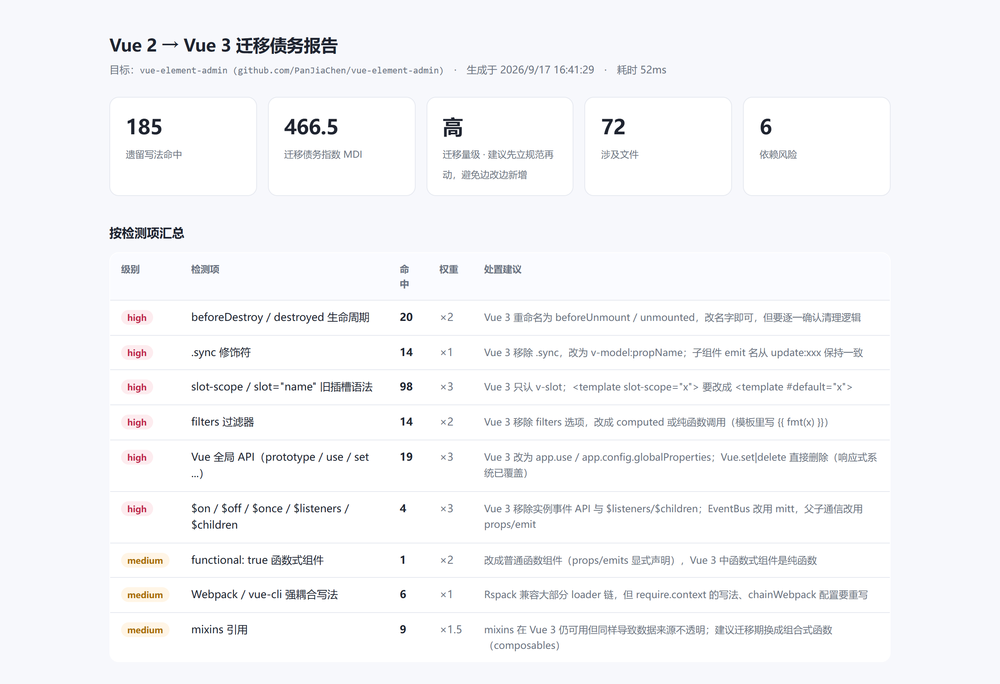

# vue2-migration-scanner

[](https://www.npmjs.com/package/vue2-migration-scanner)
[](./LICENSE)
[](https://nodejs.org)
[](./package.json)

**把「Vue 2 迁移要多久」从感觉变成数字。**

扫描 Vue 2 项目的遗留写法与依赖风险，输出「文件:行号」清单、HTML / Markdown 报告，并用一个可解释的 **MDI 指数**（迁移债务指数）把工作量化。零依赖，`npx` 直接跑。

```bash
npx vue2-migration-scanner               # 扫描当前目录
npx vue2-migration-scanner ./src         # 扫描指定目录
```



> 真实样例：[vue-element-admin](https://github.com/PanJiaChen/vue-element-admin)（MIT）—— 185 处命中 / MDI 466.5 / slot-scope 98 处。[在线完整报告](https://jabo2017.github.io/vue2-migration-scanner/)

---

## 解决什么问题

Vue 2 已于 2023-12-31 停止维护。真正开始迁移时，团队通常卡在同一个地方：**没人能说清工作量**。

- 靠人肉翻代码？几百个 `.vue` 文件翻不完，而且翻完你也记不住哪一行有问题。
- 靠 grep？`grep beforeDestroy` 能搜到，但 `.sync`、`slot-scope`、`filters`、`Vue.prototype` 得搜十几次，还得手动汇总。
- 拍脑袋估工期？最后不是做不完就是过度排期。

这个工具做的事很具体：**把迁移前必须先知道的事，一次性算清楚** —— 有哪些、各多少、在哪一行、改起来成本多大、涉及多少文件、依赖要不要一起换。

---

## 能检出什么

17 类「能在源码里稳定判定」的遗留写法（不做猜测式 AST 推断，宁可少报也不误导）。
其中 7 类来自真实 Vue 2 项目迁移实战的校准（2026-11-09）——
它们在真实项目里是 `.sync` 之外最大的几类债，早期版本 0 报告：

| 级别 | 检测项 | 权重 | 说明 |
| --- | --- | --: | --- |
| high | `beforeDestroy` / `destroyed` | ×2 | Vue 3 重命名为 `beforeUnmount` / `unmounted` |
| high | `.sync` 修饰符 | ×1 | Vue 3 改为 `v-model:propName` |
| high | `@click.native` / `v-on:*.native` | ×1 | Vue 3 移除 `.native`，事件默认透传 |
| high | `slot-scope` / `slot="name"` | ×3 | Vue 3 只认 `v-slot` / `#name` |
| high | `$scopedSlots` | ×1 | Vue 3 插槽 API 合并，改 `this.$slots` |
| high | `this.$set` / `this.$delete` | ×1 | Vue 3 响应式已覆盖，直接删 |
| high | `filters` | ×2 | Vue 3 移除 `filters` 选项 |
| high | 组件 `model: {` 选项 | ×2 | Vue 3 无 model 选项；调用方无参 `v-model` 要全部改 `v-model:propName`（跨文件契约） |
| high | `Vue.prototype` / `Vue.use` / `Vue.set` … | ×3 | 改为 `app.*`，`Vue.set` 直接删 |
| high | `$on` / `$off` / `$once` / `$listeners` / `$children` | ×3 | Vue 3 移除实例事件 API |
| medium | `render(h)` / `staticRenderFns` | ×2 | Vue 3 渲染函数不再注入 `h`，需 `import { h } from 'vue'` |
| medium | `>>>` / `::v-deep` / `/deep/` | ×1 | Vue 3 SFC 只认 `:deep()`；只查样式类文件，JS 的 `>>>` 位运算不误报 |
| medium | `:attr="false"` | ×1 | Vue 3 不再因 `false` 移除 attribute，依赖「移除」语义的要改 `undefined` / `null` |
| medium | `functional: true` | ×2 | 改成普通函数组件 |
| medium | `require.context` / `process.env.VUE_APP_` / `chainWebpack` | ×1 | 构建配置需重写 |
| medium | `mixins` | ×1.5 | 可用但数据来源不透明，建议转 composable |
| medium | EventBus（`new Vue()` + `$emit`） | ×2 | 改用 `mitt` 或 Pinia |

另外还会检查：

- **依赖风险**：`vue@2` / `vue-router@2-3` / `vuex` / `element-ui` / `@vue/cli-service` / `node-sass` / `moment` / `echarts@4` / `swiper@5` / `lodash` 全量引入等。
- **兼容性提醒**：能装但升级后容易「静默失效」的包（vue-i18n 8、vuedraggable 2、bootstrap-vue…）。

---

## MDI 是怎么算的

```
MDI = Σ (该类命中数 × 该类权重)
```

权重代表**「改一处的成本」**，不是出现频率。所以 98 处 `slot-scope`（×3）会比 98 处 `.sync`（×1）算得更重 —— 因为插槽语法改写要动模板结构，而 `.sync` 基本是字符串替换。

| MDI | 量级 | 含义 |
| --: | --- | --- |
| < 50 | 低 | 写法基本干净，主要是依赖升级 |
| 50 – 200 | 中 | 需要逐文件过一遍，可流水线推进 |
| 200 – 600 | 高 | 建议先立规范再动，避免边改边新增 |
| ≥ 600 | 极高 | 建议按模块分批，先冻结新增遗留写法 |

**这个公式是公开的、可质疑的**，权重都能在 `src/rules.mjs` 里改。它的用途是**粗粒度排期与横向对比**，不是精确工期估算 —— 任何声称能算出「还需 37.5 人日」的工具都该被怀疑。

---

## 追踪迁移进度

迁移是个持续几周的过程，所以工具支持基线对比：

```bash
vue2-scan . --json baseline.json     # 迁移前存一份基线
# …改一阵子…
vue2-scan . --baseline baseline.json # 看进度：消除了多少、新增了多少
```

输出会告诉你每类规则的变化和总数变化，方便写周报，也方便发现「边改边新增」——那是迁移里最常见的失控方式。

---

## 按模块看（--by-dir）

迁移排期是**按模块组织的，不是按文件**。「哪个目录先清、哪个目录能整块切走」要看目录维度的债务分布：

```bash
vue2-scan . --by-dir
```

按 MDI 降序列出目录（命中数 / MDI / 文件数），JSON / HTML / MD 报告里始终包含完整清单。纯聚合，不做任何新判定。

---

## v-model 契约扫描（--contracts）

这是单文件 grep 永远查不出来的一类问题：组件用 `model: { prop, event }` 声明了**非默认** v-model 契约，调用方却写着无参 `v-model="x"` —— Vue 2 里跑得好好的，Vue 3 会**静默绑错 prop**。

```bash
vue2-scan . --contracts
```

扫描器跨文件做**确定性关联**（只走相对路径 import 的 ESM 语义解析），把三件事分清楚：

| 分类 | 定性 | 说明 |
| --- | --- | --- |
| 需改 `v-model:propName` 的调用点 | **命中** | 相对 import 关联到声明了非默认契约的组件 |
| 未能关联的无参 v-model | 信息（非命中） | 别名 import（`@/...`）、全局注册组件（`el-*`）解析不了 —— 不猜映射，列出来人工核对 |
| 契约命中 | 不计入 MDI | MDI 保持单文件口径，`--baseline` 对比不被跨文件分析污染 |

「宁可少报，不可误导」在这里的体现：解析不了的**不猜**，宁可放进信息清单让人核对，也不输出一个可能指错文件的「命中」。

---

## Vue 3 项目的口径自动切换

扫描器读目标项目 `package.json` 的版本号（只认事实，不做推断）：

- **Vue 2**：报告是「迁移前盘点」—— 这些命中就是你还没开始迁的部分；
- **Vue 3 + `@vue/compat`**：报告是「过渡期阻塞清单」—— 同样的命中，含义完全不同：它们**现在仍在运行**，是移除 compat（全局切 MODE 3）前必须清零的项；`@vue/compat` 本身也会出现在兼容性提醒里；
- **Vue 3（无 compat）**：命中是残留的 Vue 2 写法，可能运行时报错或静默行为差异。

规则和 MDI 公式不变，切换的只是报告的口径与文案 —— 三个场景下报告标题旁会出现对应的说明。

---

## 接进 CI

```bash
vue2-scan . --ci --max-mdi 200
```

MDI 超阈值时退出码为 `1`，可以挂在 PR 流水线上，**防止迁移期间新增遗留写法**（先冻结，再递减）。

GitHub Actions 示例：

```yaml
- name: Vue 2 迁移债务检查
  run: npx vue2-migration-scanner . --ci --max-mdi 200
```

---

## 真实样例

对公开项目 [vue-element-admin](https://github.com/PanJiaChen/vue-element-admin)（MIT）的扫描结果：

| 指标 | 值 |
| --- | --- |
| 扫描文件 | 218 |
| 命中 | **185 处**，涉及 **72 个文件** |
| MDI | **466.5（高）** |
| 最多的一类 | `slot-scope` 98 处 |
| 最重的文件 | `src/views/table/complex-table.vue`（17 处） |
| 依赖风险 | 6 个（vue 2.6.10 / vue-router 3 / vuex 3 / element-ui 2 / echarts 4 / vue-cli 4） |

> 样例仅用于演示工具输出，不带任何评价意味 —— 这是一个写得相当好的项目，它只是**恰好在 Vue 2 时代**。

完整报告见 [在线样例](https://jabo2017.github.io/vue2-migration-scanner/)（HTML 报告可直接下载存档）。

---

## CLI

```
vue2-scan [目录] [选项]

--ext <list>        扫描后缀，逗号分隔（默认 .vue,.js,.ts,.jsx,.tsx,.mjs,.cjs）
--ignore <list>     额外跳过的路径（相对目标目录）
--json <file>       输出 JSON 报告（含每一条的文件与行号）
--html <file>       输出自包含 HTML 报告（无外链无脚本，可存档可发群）
--md <file>         输出 Markdown 报告（适合贴 PR / 周报）
--baseline <file>   对比上次的 JSON 报告，输出迁移进度
--by-dir            终端按目录聚合展示（JSON/HTML/MD 报告始终包含）
--contracts         v-model 契约扫描：跨文件关联 model 选项组件与无参 v-model 调用方
--max-mdi <n>       MDI 超过该值则以退出码 1 结束
--ci                等价于 --max-mdi 200 --quiet
--top <n>           终端展示前 n 个最重的文件（默认 10）
--quiet             只输出结论
--no-color          关闭颜色

退出码  0 正常 / 1 MDI 超标 / 2 参数或目录错误
```

默认跳过 `node_modules`、`dist`、`lib`、`es`、`build`、`public` 等目录（跑产物会把「压缩后的框架内部实现」算成你的债务，数字虚高）。**跳过了哪些目录会在输出里列出来**，不做静默忽略。

---

## 局限（请先读这段）

- **基于正则可稳定判定的模式，不做 AST 推断。** 这会漏掉一些需要语义分析才能确认的情况。这是刻意的取舍：误报会让团队不信任工具，比漏报更糟。
- **`filters` 的插值检测只认单管道符**：`{{ a | fmt }}` 报、`{{ a || b }}` 不报（早期版本曾把 `||` 或运算误报成过滤器，已在多个真实项目实测数据上修复为 0 误报）。
- **`model: {` 按行首匹配**，极少数普通对象键会多报，以 file:line 逐条核对为准。
- **`--contracts` 只对相对路径 import 做关联**：别名 import（`@/...`）与全局注册组件（`el-*`）解析不了 —— 这些进「未关联」信息清单，不算命中；不读 webpack/rspack 配置是刻意的，猜映射比不关联更危险。另外无参 v-model 的标签检测在模板注释、源码字符串里可能多报，以 file:line 核对为准。
- **深度选择器只查样式类文件**（`.vue/.css/.scss` 等），JS 里的 `>>>` 零填充右移不会误报；`.vue` 的 `<script>` 块里若有 `>>>` 位运算仍会命中，属可接受多报。
- **MDI 是相对指标，不是工期。** 用来横向对比、追踪趋势、设 CI 阈值；不要拿它当排期承诺。
- **`filters` / `slot` 之类规则在极少数写法下可能多报**，看报告时以文件:行号为准，逐条核对。
- **不自动改代码。** 只报告。改代码请用 codemod 类工具或人工，迁移期最怕的就是批量改错。
- **默认跳过 `node_modules` 等目录**，因此"以源码形态随包发布"的内部组件库（如 monorepo 之外单独发包、业务工程一起编译的那种）不在扫描范围；要覆盖它们，把扫描目标指到组件库仓库根目录单独跑一份。vendor 来的补丁源码目录（如 `compat/`）也会算进债务，介意的话用 `--ignore` 排除。

---

## 常见问题

**能扫 monorepo 吗？** 可以，指向子包目录即可，`--ext` / `--ignore` 按需调整。

**扫描结果里的「跳过 N 个文件」是什么？** 二进制或读取失败的文件，不计入统计，会在 JSON 的 `skippedDirs` / 计数里体现。

**和 `gogocode` / `vue-codemod` 什么关系？** 不冲突。那些是**改代码**的（codemod），这个是**量工作量**的（scanner）。实践中先扫一遍定范围，再上 codemod 批量改。

---

## License

MIT © 2026 Jabo

---

<sub>零依赖 · 只用 Node 内置模块 · Node.js ≥ 18</sub>
